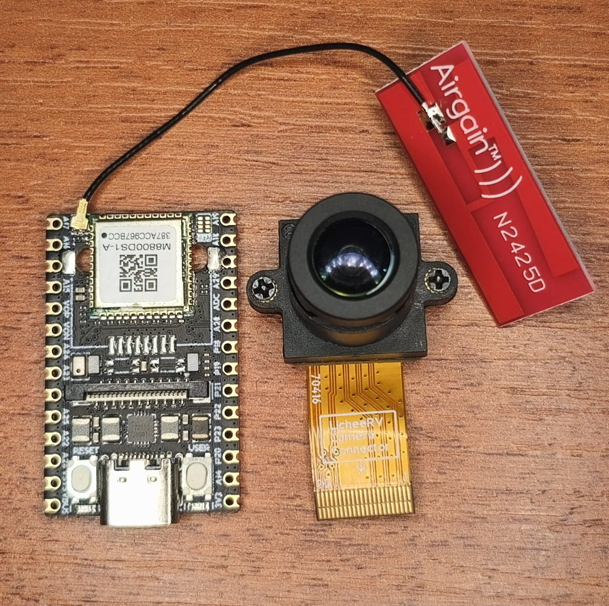
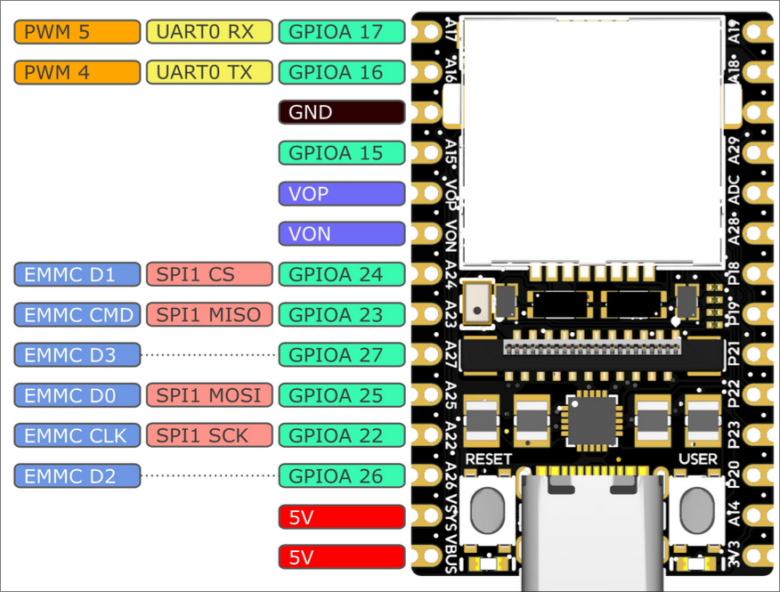
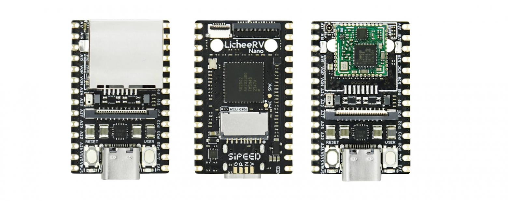
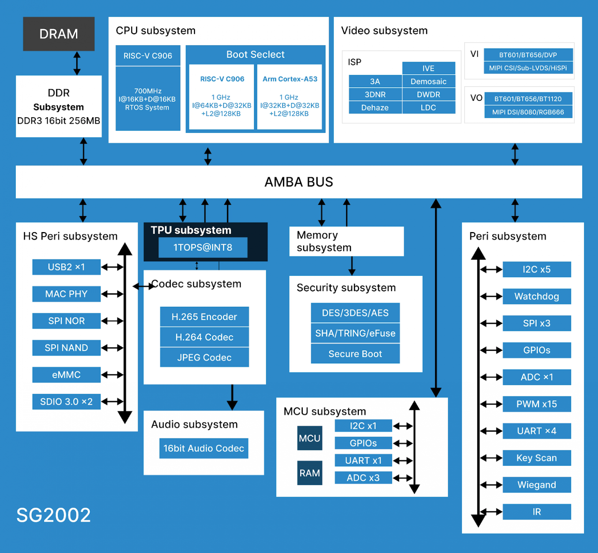
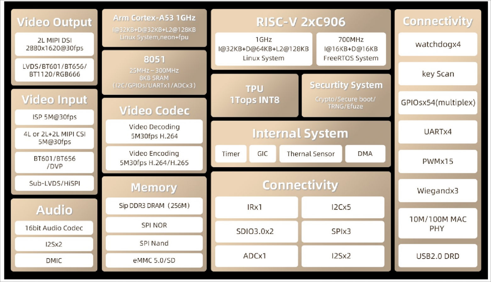
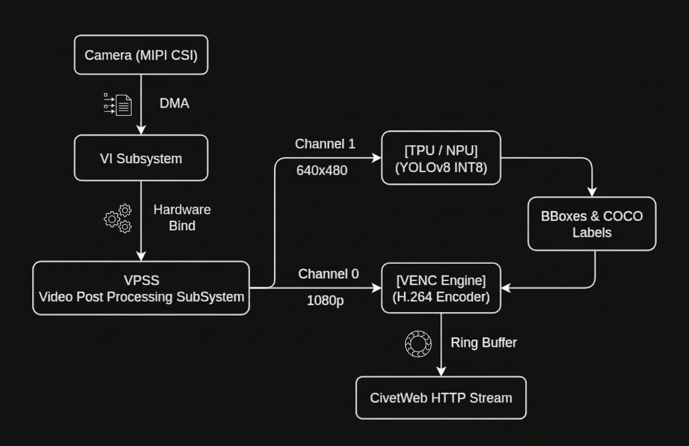

# LicheeRV Nano (SG2002) — Buildroot & Edge AI

**Undergraduate Thesis | Universidad Nacional de Colombia — Bogotá Campus**

*Implementation and Optimization of a YOLO Model on the LicheeRV Nano (SG2002) Embedded Platform for Object Detection with Replicable Documentation in Educational Environments.*

| Academic Information | Details | 
| ----- | ----- | 
| **Author** | Jesús Antonio López Trigozo | 
| **Institution** | Universidad Nacional de Colombia | 
| **Campus** | Bogotá | 
| **Faculty** | Faculty of Engineering | 
| **Advisor** | Carlos Iván Camargo Bareño | 
| **Status** | 🟡 In Progress | 

## Table of Contents

- [01. Project Overview](#01-project-overview)
- [02. Hardware Platform](#02-hardware-platform)
  - [LicheeRV Nano — SG2002](#licheerv-nano--sg2002)
  - [Board Variants](#board-variants)
  - [Hardware Diagrams & Visual References](#hardware-diagrams--visual-references)
- [03. Development Environment Setup](#03-development-environment-setup)
  - [3.1. Host Prerequisites & Docker Installation](#31-host-prerequisites--docker-installation)
  - [3.2. Clone the Build Environment](#32-clone-the-build-environment)
  - [3.3. Start the Docker Container](#33-start-the-docker-container)
- [04. Base Dependencies & Software Setup](#04-base-dependencies--software-setup)
  - [4.1. Clone CVI TDL SDK](#41-clone-cvi-tdl-sdk)
  - [4.2. Clone CivetWeb Repository](#42-clone-civetweb-repository)
- [05. System Compilation & Application Build](#05-system-compilation--application-build)
  - [5.1. Configure Buildroot Environment](#51-configure-buildroot-environment)
  - [5.2. Build Base System Image (build_all)](#52-build-base-system-image-build_all)
  - [5.3. Cross-Compile and Install CivetWeb Library](#53-cross-compile-and-install-civetweb-library)
  - [5.4. Deploy and Compile Application (http_streamer_tdl)](#54-deploy-and-compile-application-http_streamer_tdl)
  - [5.5. Clone YOLOv8 Model Repository](#55-clone-yolov8-model-repository)
  - [5.6. Container Directory Structure](#56-container-directory-structure)
- [06. System Image Deployment](#06-system-image-deployment)
  - [6.1. Collect Dynamic Shared Libraries](#61-collect-dynamic-shared-libraries)
  - [6.2. Flash Base Image to MicroSD Card](#62-flash-base-image-to-microsd-card)
  - [6.3. Mount Target Rootfs Partition](#63-mount-target-rootfs-partition)
  - [6.4. Stage Binary, Model, and Dynamic Libraries](#64-stage-binary-model-and-dynamic-libraries)
  - [6.5. Configure System Library Path (LD_LIBRARY_PATH)](#65-configure-system-library-path-ld_library_path)
  - [6.6. Configure Wireless Network & Auto-Startup Script](#66-configure-wireless-network--auto-startup-script)
  - [6.7. Flush Buffers and Safely Unmount Card](#67-flush-buffers-and-safely-unmount-card)
  - [6.8. Identify Board IP Address on Network](#68-identify-board-ip-address-on-network)
  - [6.9. Connect Through SSH & Verify Deployment](#69-connect-through-ssh--verify-deployment)
- [07. Current Development Scope](#07-current-development-scope)
- [08. Software Architecture & Thermal/Performance Optimization](#08-software-architecture--thermalperformance-optimization)
  - [8.1. Source File Responsibilities](#81-source-file-responsibilities)
  - [8.2. Core Optimization Strategies for Low CPU Usage & Heat Reduction](#82-core-optimization-strategies-for-low-cpu-usage--heat-reduction)
- [09. References & Repositories](#09-references--repositories)

---

## 01. Project Overview

This project focuses on preparing a customized embedded Linux environment for **YOLO-based object detection** on the LicheeRV Nano, powered by the SG2002 SoC.

The current work covers system configuration, image compilation, development tools, network connectivity, and the software environment required for AI deployment on resource-constrained hardware.

**Project objectives**

- Customize and compile a Buildroot-based Linux image.
- Reduce unnecessary software and system overhead.
- Configure network connectivity and remote access.
- Prepare the CVI TDL SDK for application development.
- Integrate CivetWeb for HTTP streaming.
- Document the workflow for reproducibility in educational environments.

---

## 02. Hardware Platform

### LicheeRV Nano — SG2002

| Component | Specification |
|---|---|
| **SoC** | SOPHGO SG2002 |
| **Main core** | 1 GHz RISC-V C906 / ARM Cortex-A53 (selectable) |
| **Secondary core** | 700 MHz RISC-V C906 |
| **Low-power core** | 8051, 25–300 MHz |
| **Memory** | 2 Gbit (256 MB) DDR3 |
| **AI accelerator** | Integrated NPU — 1 TOPS INT8, BF16 support |
| **Storage** | TF card / SD NAND |
| **Video output** | 2-lane MIPI DSI, 31-pin interface |
| **Camera input** | 4-lane MIPI CSI, 22-pin interface |
| **Audio** | Onboard amplifier and analog microphone |
| **Wired network** | 100 Mbps Ethernet on E and WE variants |
| **Wireless network** | Dual-band Wi-Fi 6 and Bluetooth 5.4 on W and WE variants |
| **USB** | 1 × USB 2.0 OTG Type-C |
| **Expansion** | 2 × 14-pin, 2.54 mm headers |
| **Other interfaces** | RST and BOOT buttons, power and user LEDs |
| **Operating system** | Buildroot Linux / Debian |
| **Dimensions** | 22.86 × 35.56 mm |

### Board Variants

| Variant | Ethernet | Wi-Fi 6 | Bluetooth |
|---|---|---|---|
| **LicheeRV-Nano-B** | No | No | No |
| **LicheeRV-Nano-E** | Yes | No | No |
| **LicheeRV-Nano-W** | No | Yes | Yes |
| **LicheeRV-Nano-WE** | Yes | Yes | Yes |

### Hardware Diagrams & Visual References

<table width="100%">
  <tr>
    <th width="50%" align="center">Target Board & Camera Setup</th>
    <th width="50%" align="center">Pinout Diagram</th>
  </tr>
  <tr>
    <td align="center" valign="middle">
      
    </td>
    <td align="center" valign="middle">
      
    </td>
  </tr>
</table>

<table width="100%">
  <tr>
    <th align="center">Board Variants & Physical Layout</th>
  </tr>
  <tr>
    <td align="center" valign="middle">
      
    </td>
  </tr>
</table>

<table width="100%">
  <tr>
    <th width="50%" align="center">SG2002 Subsystem Block Diagram</th>
    <th width="50%" align="center">SG2002 System Architecture</th>
  </tr>
  <tr>
    <td align="center" valign="middle">
      
    </td>
    <td align="center" valign="middle">
      
    </td>
  </tr>
</table>

---

## 03. Development Environment Setup

The build environment uses Docker to isolate dependencies and provide a consistent workspace for compiling the system.

### 3.1. Host Prerequisites & Docker Installation

To avoid permission conflicts during rootfs generation and container mounting, switch to superuser privileges (`root`) and navigate to its home directory before starting:

```bash
sudo su
cd /root
```

Install `curl` and deploy Docker on the host system using the official installation script:

```bash
apt update && apt install curl -y && curl -fsSL https://get.docker.com | sh
```

### 3.2. Clone the Build Environment

Run these commands on the **host machine** to download the source code and build the Docker image:

```bash
git clone https://github.com/sipeed/LicheeRV-Nano-Build --depth=1
cd LicheeRV-Nano-Build
git clone https://github.com/sophgo/host-tools --depth=1
cd host/ubuntu
docker build -t licheervnano-build-ubuntu .
```

### 3.3. Start the Docker Container

Run this command on the host machine, replacing the source path with the absolute path of your local repository:

```bash
docker run -v /root/LicheeRV-Nano-Build/:/workspace -it licheervnano-build-ubuntu /bin/bash
```

Once inside the container, `/workspace` serves as the root working directory representing the `LicheeRV-Nano-Build` tree.

---

## 04. Base Dependencies & Software Setup

### 4.1. Clone CVI TDL SDK

Inside the container's `/workspace` directory:

```bash
cd /workspace
git clone https://github.com/milkv-duo/cvitek-tdl-sdk-sg200x.git --depth=1
```

**Directory requirement:** The CVI TDL repository must be located at `/workspace/cvitek-tdl-sdk-sg200x` inside the container.

### 4.2. Clone CivetWeb Repository

Clone version `v1.15` of CivetWeb into the workspace directory:

```bash
cd /workspace
git clone --branch v1.15 --depth=1 https://github.com/civetweb/civetweb.git
```

---

## 05. System Compilation & Application Build

### 5.1. Configure Buildroot Environment

Execute the following commands **inside the container**:

```bash
cd /workspace
source build/cvisetup.sh
defconfig sg2002_licheervnano_sd
git config --global --add safe.directory /workspace
```

### 5.2. Build Base System Image (build_all)

Trigger the primary base build process **before** placing custom application code. This step builds kernel headers, toolchains, ISP header files, middleware libraries, and the Buildroot sysroot:

```bash
cd /workspace
build_all
```

> **Note:** The full base compilation (`build_all`) is a highly resource-intensive process. Depending on host hardware capabilities (CPU core count, RAM allocation, and disk I/O speed), this step typically takes between **30 minutes to over 1 hour** to complete.

Once compilation successfully completes, the build system generates the final flashable image inside the following path:

```text
/workspace/install/soc_sg2002_licheervnano_sd/images/<TIMESTAMP_AND_HASH>.img
```

*(For example: `/workspace/install/soc_sg2002_licheervnano_sd/images/2026-10-31-01-07-d4003f.img` or generically referred to as `xxx.img` since the timestamp and commit hash vary with each build execution).*

### 5.3. Cross-Compile and Install CivetWeb Library

To prevent compilation errors caused by missing CivetWeb headers or static libraries during application build, cross-compile CivetWeb using the RISC-V toolchain and install `libcivetweb.a` and `civetweb.h` directly into Buildroot's sysroot directory:

```bash
cd /workspace/civetweb && make WITH_CPP=0 WITH_LUA=0 WITH_IPV6=1 COMS_CFLAGS="-O2" CC=/workspace/host-tools/gcc/riscv64-linux-musl-x86_64/bin/riscv64-unknown-linux-musl-gcc AR=/workspace/host-tools/gcc/riscv64-linux-musl-x86_64/bin/riscv64-unknown-linux-musl-ar lib && cp libcivetweb.a /workspace/buildroot/output/host/riscv64-buildroot-linux-musl/sysroot/usr/lib/ && cp include/civetweb.h /workspace/buildroot/output/host/riscv64-buildroot-linux-musl/sysroot/usr/include/
```

### 5.4. Deploy and Compile Application (http_streamer_tdl)

Clone the streaming application repository into a temporary directory, move only the `http_streamer_tdl` project folder into the Buildroot middleware path, and clean up the temporary repository:

```bash
git clone https://github.com/m0nkeyh4ck/licheerv-nano-sg2002-yolo-streaming /tmp/repo
mv /tmp/repo/http_streamer_tdl /workspace/middleware/v2/sample/ && rm -rf /tmp/repo
```

Now navigate to the application directory and compile it:

```bash
cd /workspace/middleware/v2/sample/http_streamer_tdl
make clean
make
```

### 5.5. Clone YOLOv8 Model Repository

Inside the container's `/workspace` directory, clone the repository containing the pre-compiled INT8 YOLOv8 model file (`yolov8n_cv181x_int8_sym.cvimodel`):

```bash
cd /workspace
git clone https://github.com/zwyzwm/YOLOv8-Object-Detection.git
```

### 5.6. Container Directory Structure

The complete project directory tree inside the container is organized as follows:

```text
/workspace/
├── build/
├── buildroot/
│   └── output/
│       └── host/
│           └── riscv64-buildroot-linux-musl/
│               └── sysroot/
├── civetweb/
│   ├── include/
│   │   └── civetweb.h
│   └── src/
│       └── civetweb.c
├── cvitek-tdl-sdk-sg200x/
├── middleware/
│   └── v2/
│       └── sample/
│           └── http_streamer_tdl/
│               ├── fmp4_init_segment.c
│               ├── fmp4_init_segment.h
│               ├── http_streamer_tdl.c
│               ├── Makefile
│               ├── mse_stream.c
│               ├── mse_stream.h
│               ├── sensor_config.c
│               ├── sensor_config.h
│               ├── vb_pool.c
│               ├── vb_pool.h
│               ├── venc_handler.c
│               ├── venc_handler.h
│               ├── vi_init.c
│               ├── vi_init.h
│               ├── vpss_init.c
│               ├── vpss_init.h
│               ├── web_handler.c
│               └── web_handler.h
└── YOLOv8-Object-Detection/
    ├── README.md
    └── yolov8n_cv181x_int8_sym.cvimodel
```

---

## 06. System Image Deployment

> **Execution Context Note:** All steps in Section 06 are performed **on the host machine (outside the Docker container)**. Exit the container (`exit`) or open a new host terminal. Direct host OS privileges are required to access physical block devices (`/dev/sdX`), mount SD card partitions, scan local network ranges, and initiate SSH sessions.

### 6.1. Collect Dynamic Shared Libraries

Before writing the system to the MicroSD card, gather all dynamic shared libraries (`.so`) required by OpenCV, TPU, and CVI TDL SDK into a single flat directory (`/root/LicheeRV-Nano-Build/libraries`). 

Run `collect_libraries.sh` on your host machine:

```bash
cd /root/LicheeRV-Nano-Build

cat << 'EOF' > collect_libraries.sh
#!/bin/bash
BASE="/root/LicheeRV-Nano-Build"
DEST="/root/LicheeRV-Nano-Build/libraries"

rm -rf "$DEST"
mkdir -p "$DEST"

echo "Extracting dynamic libraries into flat structure..."
find "$BASE/install/soc_sg2002_licheervnano_sd/rootfs/mnt/system/usr/lib" -type f -name '*.so*' -exec cp -n -t "$DEST" {} +
find "$BASE/install/soc_sg2002_licheervnano_sd/rootfs/mnt/system/usr/lib/3rd" -type f -name '*.so*' -exec cp -n -t "$DEST" {} +
find "$BASE/cvitek-tdl-sdk-sg200x/lib" -type f -name '*.so*' -exec cp -n -t "$DEST" {} +
find "$BASE/cvitek-tdl-sdk-sg200x/sample/3rd/tpu/lib" -type f -name '*.so*' -exec cp -n -t "$DEST" {} +
find "$BASE/cvitek-tdl-sdk-sg200x/sample/3rd/opencv/lib" -type f -name '*.so*' -exec cp -n -t "$DEST" {} +

cd "$DEST"
for lib in libopencv_core libopencv_imgproc libopencv_imgcodecs; do
    if [ -f "${lib}.so.3.2.0" ] && [ ! -e "${lib}.so.3.2" ]; then
        ln -s "${lib}.so.3.2.0" "${lib}.so.3.2"
    fi
done
cd - > /dev/null
echo "Library collection completed at: $DEST"
EOF

chmod +x collect_libraries.sh
./collect_libraries.sh
```

### 6.2. Flash Base Image to MicroSD Card

Unmount any active partitions on the target SD card device (e.g., `/dev/sda`) and write the compiled system image using `dd`:

```bash
# Unmount target block device partitions
sudo umount /dev/sda* 2>/dev/null

# Flash image to the SD card (Replace image name with your compiled output)
IMG_PATH="/root/LicheeRV-Nano-Build/install/soc_sg2002_licheervnano_sd/images/YOUR_IMAGE_NAME.img"
sudo dd if="$IMG_PATH" of=/dev/sda bs=4M status=progress conv=fsync
sync
```

### 6.3. Mount Target Rootfs Partition

Create a mount mountpoint on the host OS and mount the second partition (`rootfs`) of the MicroSD card:

```bash
sudo mkdir -p /mnt/sd_rootfs
sudo mount /dev/sda2 /mnt/sd_rootfs
```

### 6.4. Stage Binary, Model, and Dynamic Libraries

Copy the compiled application binary, the YOLO model file, and the collected dynamic libraries directly into the `/root` folder of the MicroSD card:

```bash
# Copy executable binary and set execution permissions
sudo cp /root/LicheeRV-Nano-Build/middleware/v2/sample/http_streamer_tdl/http_streamer_tdl /mnt/sd_rootfs/root/
sudo chmod +x /mnt/sd_rootfs/root/http_streamer_tdl

# Copy INT8 YOLOv8 model file
sudo cp /root/LicheeRV-Nano-Build/YOLOv8-Object-Detection/yolov8n_cv181x_int8_sym.cvimodel /mnt/sd_rootfs/root/

# Copy dynamic libraries folder
sudo cp -r /root/LicheeRV-Nano-Build/libraries /mnt/sd_rootfs/root/
```

### 6.5. Configure System Library Path (LD_LIBRARY_PATH)

Configure the dynamic linker path inside `/etc/profile` so the system automatically finds shared libraries located in `/root/libraries`:

```bash
sudo bash -c "echo 'export LD_LIBRARY_PATH=\"/root/libraries:/usr/lib:/usr/local/lib:\$LD_LIBRARY_PATH\"' >> /mnt/sd_rootfs/etc/profile"
```

### 6.6. Configure Wireless Network & Auto-Startup Script

Write your wireless router credentials to `wpa_supplicant.conf` and update `/etc/init.d/rcS` to enable automatic network initialization on boot:

```bash
# Write Wi-Fi credentials
sudo mkdir -p /mnt/sd_rootfs/etc/wpa_supplicant
sudo bash -c "cat > /mnt/sd_rootfs/etc/wpa_supplicant/wpa_supplicant.conf" << 'EOF'
ctrl_interface=/var/run/wpa_supplicant
ap_scan=1
network={
  ssid="YOUR_WIFI_SSID"
  psk="YOUR_WIFI_PASSWORD"
  scan_ssid=1
}
EOF

# Append startup network routine to rcS
sudo bash -c "echo 'export LD_LIBRARY_PATH=\"/root/libraries:/usr/lib:/usr/local/lib:\$LD_LIBRARY_PATH\"' >> /mnt/sd_rootfs/etc/init.d/rcS"
sudo bash -c "echo 'rm -rf /var/run/wpa_supplicant' >> /mnt/sd_rootfs/etc/init.d/rcS"
sudo bash -c "echo 'ip link set wlan0 up' >> /mnt/sd_rootfs/etc/init.d/rcS"
sudo bash -c "echo 'wpa_supplicant -B -i wlan0 -c /etc/wpa_supplicant/wpa_supplicant.conf' >> /mnt/sd_rootfs/etc/init.d/rcS"
sudo bash -c "echo 'sleep 4' >> /mnt/sd_rootfs/etc/init.d/rcS"
sudo bash -c "echo 'udhcpc -i wlan0 -b' >> /mnt/sd_rootfs/etc/init.d/rcS"
```

### 6.7. Flush Buffers and Safely Unmount Card

Synchronize file system caches and safely unmount the partition:

```bash
sync
sudo umount /mnt/sd_rootfs
sudo rm -rf /mnt/sd_rootfs
```

---

### 6.8. Identify Board IP Address on Network

Insert the MicroSD card into the LicheeRV Nano and apply power. From the host terminal, scan the local network range to determine the board's IP address:

```bash
sudo nmap -sV -p 22 192.168.1.0/24
```

---

### 6.9. Connect Through SSH & Verify Deployment

Connect to the board over SSH using standard root credentials:

```bash
ssh root@<BOARD_IP_ADDRESS>
```

Verify that all binaries, libraries, and model assets are correctly mounted inside `/root`:

```bash
ls -la /root
```

Expected structure inside `/root`:
- `http_streamer_tdl` (Executable application)
- `yolov8n_cv181x_int8_sym.cvimodel` (YOLO model file)
- `libraries/` (Flattened dynamic `.so` libraries directory)

---

## 07. Current Development Scope

The repository documents the setup and configuration of the embedded Linux environment and the supporting software required for development on the SG2002 platform.

The current workflow covers:

- Buildroot configuration and system image compilation.
- Docker-based development environment.
- CVI TDL SDK setup and configuration.
- CivetWeb integration for HTTP streaming.
- MicroSD image deployment with dynamic library and model staging.
- Wireless networking and SSH access.

YOLO deployment, inference validation, and performance evaluation remain part of the ongoing thesis work.

---

## 08. Software Architecture & Thermal/Performance Optimization

The streaming application (`http_streamer_tdl`) is engineered specifically for resource-constrained SoC environments (SOPHGO SG2002 / CV181X). High performance, stable FPS, low CPU utilization, and minimal thermal dissipation are achieved through strict C-level design pattern optimizations.

### 8.1. Source File Responsibilities

| Module (`.c` / `.h`) | Primary Responsibility | Optimization Focus |
|---|---|---|
| `http_streamer_tdl` | Main entry point, signal handling, SDK hardware binding, thread lifecycle. | Clean subsystem tear-down and memory release. |
| `sensor_config` | Sensor initialization (`sensor_cfg.ini` parsing) and format negotiation. | Dynamic resolution setup matching hardware capability. |
| `vb_pool` | Allocation of hardware Video Buffer (VB) pools in DDR memory. | Zero-copy ISP/VPSS hardware buffer reuse across channels. |
| `vi_init` | Video Input (VI) pipeline setup for MIPI CSI capture. | Direct hardware DMA streaming from sensor to DDR. |
| `vpss_init` | Video Processing SubSystem configuration (scaling, pixel format conversion). | Dual-channel hardware scaling (1080p for stream, 640x480 for NPU). |
| `venc_handler` | H.264 encoding thread (`VENC`), NPU inference thread (`TDL`), and ring buffer. | Reusable memory ring buffer and NPU label overlay. |
| `fmp4_init_segment` | ISO/IEC 14496-12 MP4 container box builder (`ftyp`, `moov`, `moof`, `mdat`). | In-memory fast NAL unit Annex-B to AVCC conversion. |
| `mse_stream` | Media Source Extensions (MSE) HTTP chunked video streaming server handler. | Passive thread synchronization and static copy buffering. |
| `web_handler` | CivetWeb HTTP routes (`/`, `/stream`, `/stats`), HTML/JS web player interface. | Network socket I/O decoupled from mutex lock scopes. |

---

### 8.2. Core Optimization Strategies for Low CPU Usage & Heat Reduction

#### 1. Hardware Pipeline Offloading (Zero-CPU Video/AI Pipeline)
Instead of processing frames in software via CPU routines:
- **MIPI CSI Camera Capture (`VI`)** streams frames via DMA directly into hardware memory pools (`VB Pool`).
- **Video Process SubSystem (`VPSS`)** splits the capture into two hardware streams: Channel 0 scales frames to 1080p for encoding, while Channel 1 scales frames to 640x480 for NPU inference.
- **NPU Acceleration (`TPU / CVI_TDL`)** handles INT8 YOLOv8 tensor operations on dedicated silicon, leaving the RISC-V host CPU idling.
- **Hardware Encoder (`VENC`)** compresses raw NV21 frames directly into H.264 streams in real-time.

<p align="center">
  
</p>

#### 2. Zero Per-Frame Heap Allocation (Persistent Dynamic Buffering)
Executing `malloc()` and `free()` inside 30 FPS high-frequency loops causes kernel heap fragmentation, system calls overhead, thermal throttling, and CPU spikes.

To eliminate this, `venc_handler.c` and `mse_stream.c` utilize **persistent capacity-expanding buffers**. Buffers expand only when encountering larger frame sizes and reuse memory indefinitely:

```c
// Example from venc_handler.c: Ring buffer memory reuse
pthread_mutex_lock(&g_frame_lock);

int idx = g_frame_write_idx;
if (g_frame_ring[idx].capacity < total_size) {
    // Reallocate only when required by larger keyframe spikes
    uint8_t *new_ptr = realloc(g_frame_ring[idx].data, total_size + 16384);
    if (new_ptr) {
        g_frame_ring[idx].data = new_ptr;
        g_frame_ring[idx].capacity = total_size + 16384;
    }
}

// Memory is reused directly without freeing between frames
memcpy(g_frame_ring[idx].data, stStream.pstPack[i].pu8Addr, total_size);
g_frame_ring[idx].size = total_size;
```

#### 3. Passive Thread Synchronization (`pthread_cond_t` vs Polling)
Polling loops with `usleep()` consume CPU cycles during sleep-wake transitions and introduce jitter.

The streaming handlers (`mse_stream.c` and `web_handler.c`) utilize POSIX condition variables (`pthread_cond_timedwait`). When no new frame is ready, HTTP worker threads sleep passively with **0% CPU usage**, waking up instantly via `pthread_cond_broadcast()` when the `VENC` thread writes a new frame:

```c
// Example from mse_stream.c: Passive condition wait loop
pthread_mutex_lock(&g_frame_lock);
while (!g_bExit && (!g_frame_ring[next].data || next == g_frame_write_idx)) {
    struct timespec ts;
    clock_gettime(CLOCK_REALTIME, &ts);
    ts.tv_nsec += 50000000; // 50ms timeout guard
    if (ts.tv_nsec >= 1000000000) { ts.tv_sec += 1; ts.tv_nsec -= 1000000000; }
    
    // CPU thread yields completely until woken by the VENC encoder thread
    pthread_cond_timedwait(&g_frame_cond, &g_frame_lock, &ts);
    next = (last_sent_idx + 1) % BUFFER_SIZE;
}
```

#### 4. Mutex Decoupling from Network Socket I/O
Performing slow blocking socket writes (`mg_write`) inside critical section locks causes thread starvation and blocks video capture pipelines.

In `web_handler.c`, frame data is copied locally inside a fast mutex lock, and the lock is **released immediately prior to network transmission**:

```c
// Example from web_handler.c: Fast copy and lock release before I/O
pthread_mutex_lock(&g_frame_lock);
// ... wait for frame ...
memcpy(local_buf, g_frame_ring[next].data, size);
last_idx = next;

// Mutex lock is UNLOCKED before blocking TCP socket operations
pthread_mutex_unlock(&g_frame_lock);

// Network latency cannot block hardware VENC encoding thread
int written = mg_write(conn, local_buf, size);
```

#### 5. Efficient NPU Overlay & Label Mapping
In `venc_handler.c`, the NPU inference thread (`run_tdl_thread`) processes detection outputs and maps integer COCO class IDs (`stObjMeta.info[i].classes`) directly to an array of static class strings (`COCO_CLASSES[cls]`) along with confidence percentage scores (`stObjMeta.info[i].bbox.score`). Hardware vector drawing routines (`CVI_TDL_Service_ObjectDrawRect`) overlay bounding boxes and English labels on video frames prior to H.264 compression, requiring zero client-side browser rendering computation.

---

## 09. References & Repositories

1. **Sipeed LicheeRV Nano Official Documentation:**  
   [Sipeed LicheeRV Nano Wiki - Overview](https://wiki.sipeed.com/hardware/en/lichee/RV_Nano/1_intro.html)

2. **Habr Technical Article — LicheeRV Nano Testing & Development Workflow:**  
   [LicheeRV Nano Development, Integration, and Hardware Tests](https://habr.com/ru/articles/880230/)

3. **Sipeed LicheeRV-Nano-Build Repository:**  
   [Sipeed LicheeRV-Nano-Build GitHub](https://github.com/sipeed/LicheeRV-Nano-Build)

4. **SOPHGO Host Tools Repository:**  
   [SOPHGO Host Tools GitHub](https://github.com/sophgo/host-tools)

5. **CVI TDL SDK for SG200X Repository:**  
   [Milk-V Duo CVITEK TDL SDK GitHub](https://github.com/milkv-duo/cvitek-tdl-sdk-sg200x)

6. **CivetWeb Embedded HTTP Server Repository:**  
   [CivetWeb GitHub](https://github.com/civetweb/civetweb)

---

**Universidad Nacional de Colombia · Bogotá Campus**  
*Undergraduate Thesis — Embedded Systems and Edge AI*